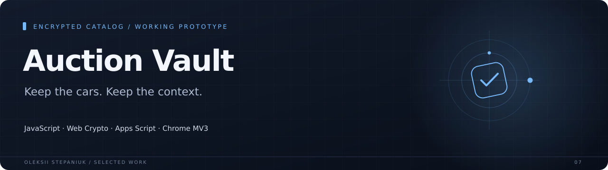
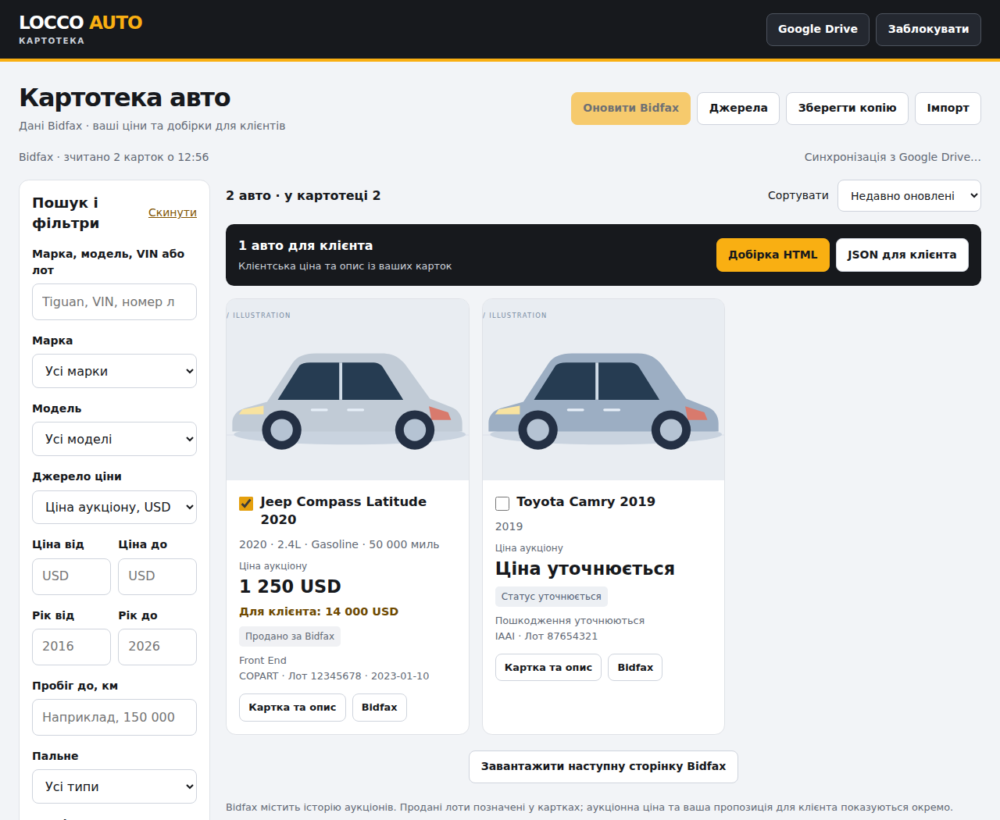

An encrypted auction catalog packaged as a standalone HTML application. A small browser bridge captures visible Bidfax listings; the catalog keeps local edits and can synchronize encrypted records with user-owned Google Drive storage.

**JavaScript · Web Crypto · Apps Script · Chrome MV3**

## Why I built it

Viewed auction lots get lost across browser tabs, while client prices and notes need to survive imports and synchronization.

## What it does

| Area | Behavior |
| --- | --- |
| **Catalog** | Search, filters, vehicle details, personal pricing and client-selection exports. |
| **Local encryption** | Password-based AES-GCM storage and encrypted backups. |
| **Synchronization** | Version checks, conflict handling and signed requests to an Apps Script backend. |
| **Capture bridge** | Reads visible Bidfax pages and preserves client edits when listings refresh. |

## Interface

## Engineering notes

`npm test` includes parser, encryption, synchronization, bridge and browser UI checks using synthetic records. No real auction account or customer data is needed.

The latest packaging checks are recorded in [docs/verification.md](docs/verification.md).

## Project state

Working prototype. The catalog and synchronization behavior have fixture-based tests. Live Apps Script deployment and end-to-end Bidfax capture still need user-side validation. A Drive folder and access key must be configured by the owner.

## Source

Implementation source is not included in this case-study repository.

---

[Oleksii Stepaniuk](https://github.com/bird24h) · [Project collection](../README.md)
