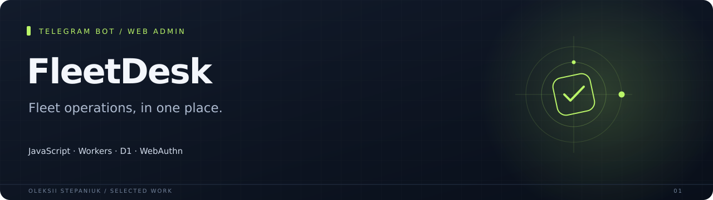
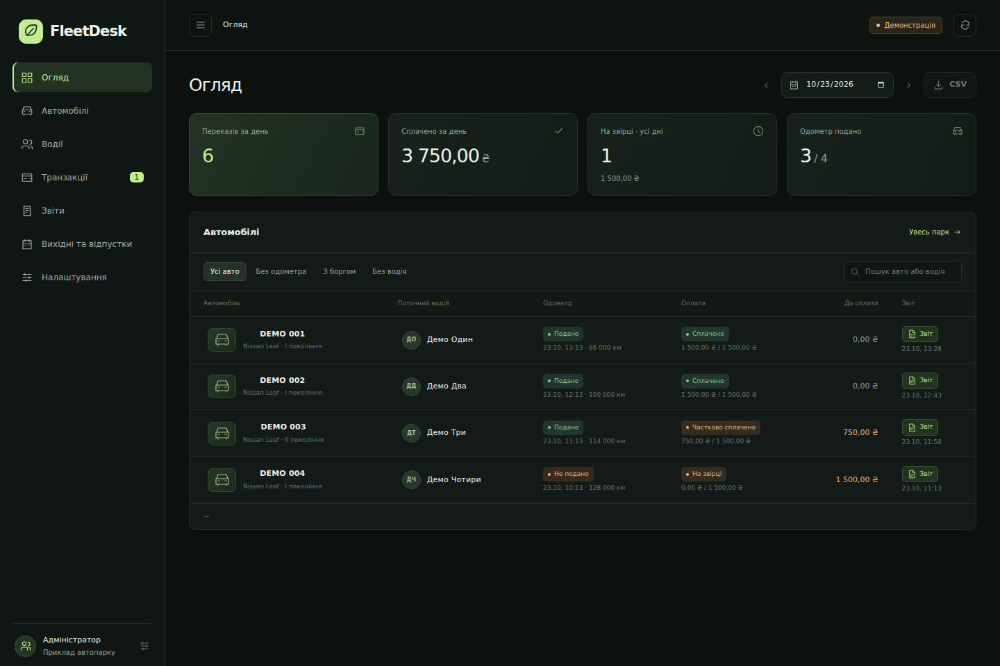

Telegram workflows for drivers and a browser dashboard for fleet managers. The bot handles registration, vehicle assignment, shift photos, reports and payments; the web panel brings those records together.

**JavaScript · Workers · D1 · WebAuthn**

## Why I built it

A fleet needs one place to see who is driving, which shifts are open, what has been paid and which balances need attention.

## What it does

| Area | Behavior |
| --- | --- |
| **Driver workflow** | Registration, vehicle selection, shift start and finish, odometer photos, shift history. |
| **Fleet administration** | Vehicles and drivers, assignments, payment status, balances and tariff settings. |
| **Payment handling** | Receipt review, payment records, debt reminders and an optional Monobank integration. |
| **Web access** | A dedicated admin interface with server-side sessions and passkey support. |

## Interface

## Engineering notes

`npm run check` validates the entry point and release bundle. The publication checks also create a fresh SQLite database from all nine migrations. Live Telegram, bank and passkey flows require a configured deployment.

The latest packaging checks are recorded in [docs/verification.md](docs/verification.md).

## Project state

Public source release based on the 1.11.0 Worker distribution. Payment details and deployment identifiers are replaced with examples. It needs your own D1 database and Telegram configuration.

## Source

Implementation source is not included in this case-study repository.

---

[Oleksii Stepaniuk](https://github.com/bird24h) · [Project collection](../README.md)
