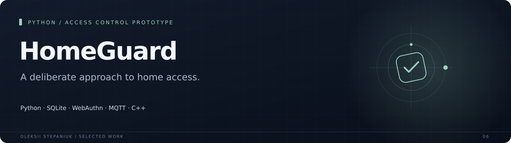
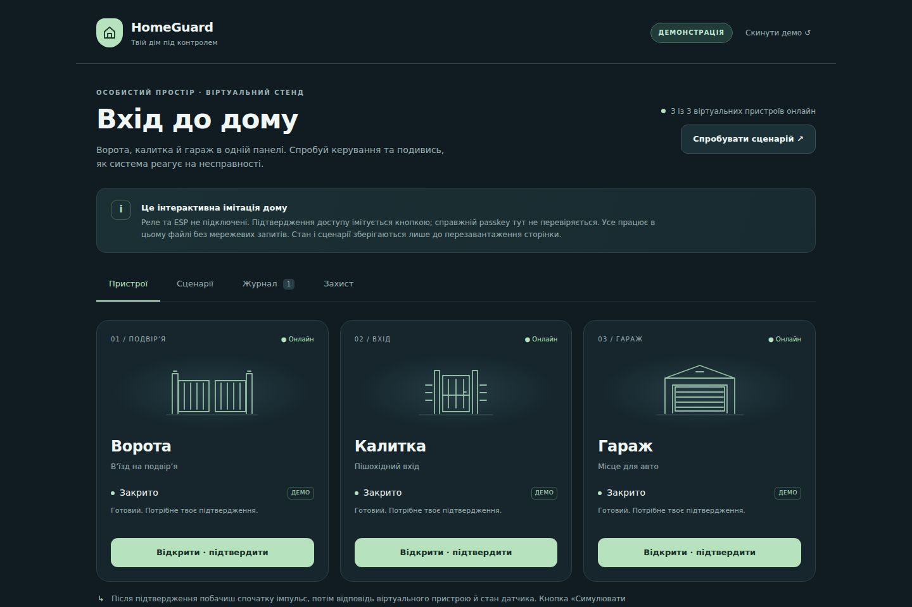

A home-access prototype with a mobile panel, passkey verification, a command-policy kernel and an MQTT adapter. A virtual bench makes the decisions and failure cases inspectable before hardware is connected.

**Python · SQLite · WebAuthn · MQTT · C++**

## Why I built it

A gate command has physical consequences. Authentication, fresh device state and command delivery need clear boundaries, especially when the network fails.

## What it does

| Area | Behavior |
| --- | --- |
| **Owner verification** | WebAuthn pairing and sessions, with fresh verification for each access action. |
| **Command policy** | Single-use grants, short TTLs, sequence checks, cooldowns and persistent audit records. |
| **Device protocol** | Signed commands, independent command/event keys and an MQTT/mTLS adapter. |
| **Failure handling** | Unknown outcomes block automatic retries; commissioning and local recovery are documented. |

## Interface

## Engineering notes

The Python suite covers authentication, server limits, command policy, gateway and recovery. The simulator exercises the command lifecycle. Physical relays, phone authenticators and a real broker need commissioning.

The latest packaging checks are recorded in [docs/verification.md](docs/verification.md).

## Project state

Prototype version 0.2. The virtual bench and policy kernel are implemented. GPIO firmware, physical commissioning, cameras, arrival proof and automatic gate operation are outside this release. Real-device commands are disabled in the example registry.

## Source

Implementation source is not included in this case-study repository.

---

[Oleksii Stepaniuk](https://github.com/bird24h) · [Project collection](../README.md)
