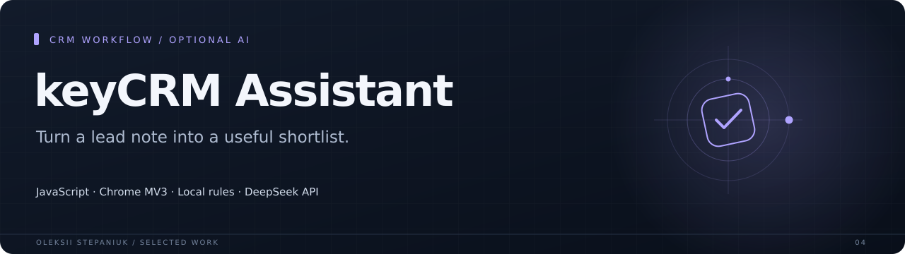
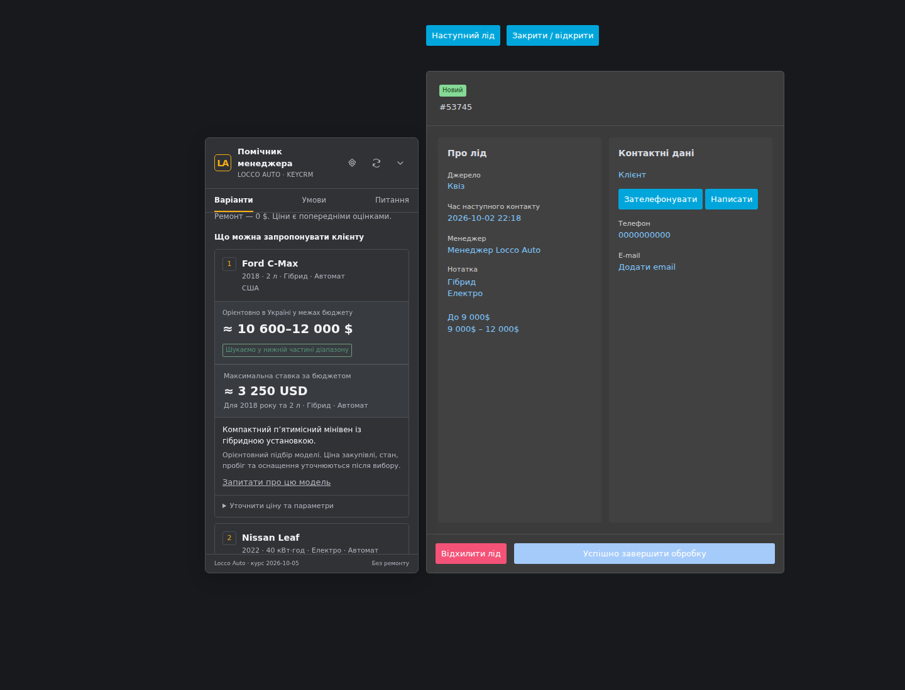

An embedded assistant for automotive lead qualification in keyCRM. It extracts the client requirements, applies local budget and market rules, and prepares model suggestions and a message for the client.

**JavaScript · Chrome MV3 · Local rules · DeepSeek API**

## Why I built it

A lead note contains the budget and preferences, while the manager still has to translate them into suitable models and useful follow-up questions.

## What it does

| Area | Behavior |
| --- | --- |
| **Lead parsing** | Budget, year range, fuel, gearbox, body, mileage, brands and preferences. |
| **Local matching** | Model catalog, market selection and budget checks work without an AI key. |
| **Manager workflow** | Per-lead edits, price corrections, model explanations and copy-ready summaries. |
| **Optional AI** | Additional questions through a user-supplied DeepSeek key, with contact masking. |

## Interface

## Engineering notes

`npm test` covers lead changes, model filtering, budget boundaries, local calculations, panel placement, manual overrides and mocked provider behavior.

The latest packaging checks are recorded in [docs/verification.md](docs/verification.md).

## Project state

Version 2.1.0. Model prices are consultation estimates rather than live auction offers. No personal API key or customer database is included. Live keyCRM installation and provider calls depend on the user configuration.

## Source

Implementation source is not included in this case-study repository.

---

[Oleksii Stepaniuk](https://github.com/bird24h) · [Project collection](../README.md)
