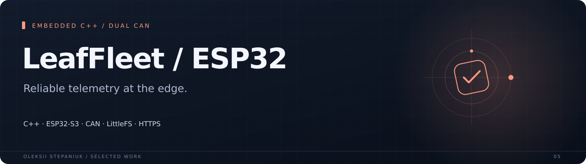
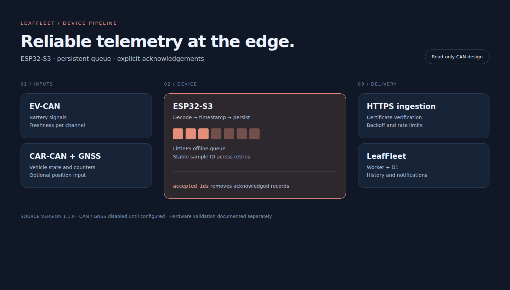

ESP32-S3 firmware for the LeafFleet telemetry pipeline. It combines vehicle decoding with a persistent offline queue, explicit delivery acknowledgements, signal freshness and a read-only CAN design.

**C++ · ESP32-S3 · CAN · LittleFS · HTTPS**

## Why I built it

A vehicle device has intermittent Wi-Fi, limited storage and signals that can disappear. Uploading a reading must not turn a failed connection into lost history or a stale vehicle state.

## What it does

| Area | Behavior |
| --- | --- |
| **Vehicle inputs** | EV-CAN, CAR-CAN and optional UART GNSS, with per-channel freshness. |
| **Offline delivery** | LittleFS queue, stable sample IDs, exact acknowledgements, retry policy and bounded storage. |
| **Transport** | HTTPS certificate verification, clock synchronization and reconnect handling. |
| **Provisioning** | USB configuration and diagnostics; hardware channels remain disabled until fitted. |

## Interface

## Engineering notes

Native decoder and driver-analytics tests can run with g++. The protocol test additionally needs ArduinoJson headers. Hardware timing, CAN signals and board builds must be validated on the intended ESP32-S3 setup.

The latest packaging checks are recorded in [docs/verification.md](docs/verification.md).

## Project state

Firmware source version 1.1.0. Host-side tests cover decoding and counters. CAN and GNSS are disabled by default. The public source uses an example ingest URL; board builds and signal verification on the target vehicle are separate steps. Prebuilt binaries are excluded.

## Source

Implementation source is not included in this case-study repository.

---

[Oleksii Stepaniuk](https://github.com/bird24h) · [Project collection](../README.md)
