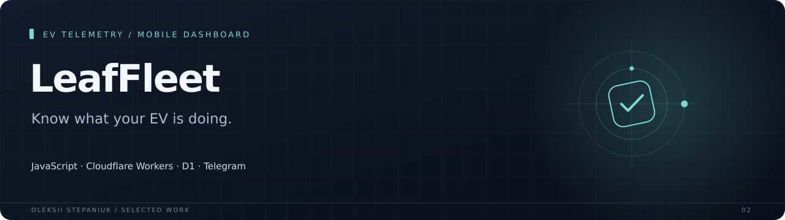
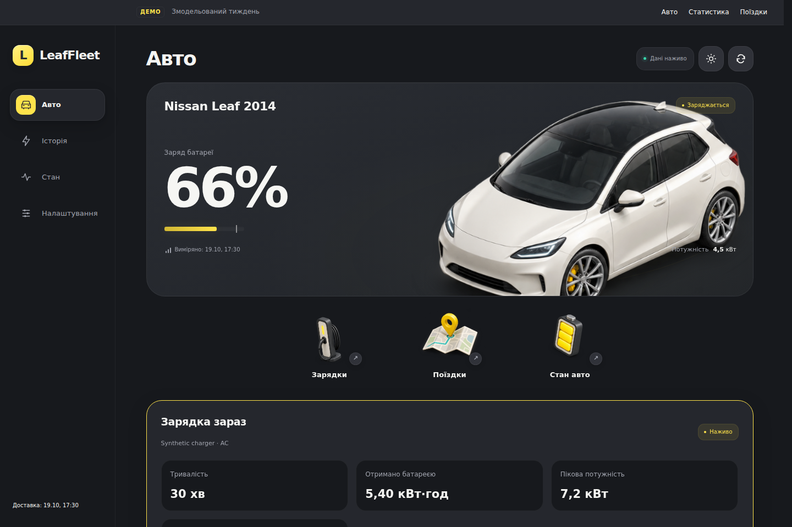

A mobile dashboard and telemetry service for a Nissan Leaf. It connects battery readings, charging history, trips, device health and notifications in one interface, with a local demonstration that runs without a vehicle.

**JavaScript · Cloudflare Workers · D1 · Telegram**

## Why I built it

A Nissan Leaf exposes useful battery and trip information, but it is scattered across the car, charging sessions and separate tools.

## What it does

| Area | Behavior |
| --- | --- |
| **Vehicle overview** | Battery state, charging power, energy, freshness and connection diagnostics. |
| **History** | Charging sessions, trips, events and day-based summaries. |
| **Cloud ingestion** | Worker endpoints, D1 storage, migration logic and scheduled notifications. |
| **Access** | Telegram launch-data verification and separate administrator and device credentials. |

## Interface

## Engineering notes

`npm test` exercises the application logic, API contract, Telegram access checks and controller behavior using isolated fixtures. Hardware behavior and notifications on a real phone need a live installation.

The latest packaging checks are recorded in [docs/verification.md](docs/verification.md).

## Project state

The cloud implementation is version 1.2.0, with a later standalone 2.5 demonstration interface. Public preview data is generated from fixed synthetic values without coordinates or user profiles. Physical vehicle validation remains a separate hardware step.

## Source

[Public cloud source release](https://github.com/bird24h/locco-auto-privacy/tree/leaffleet/leaffleet)

---

[Oleksii Stepaniuk](https://github.com/bird24h) · [Project collection](../README.md)
