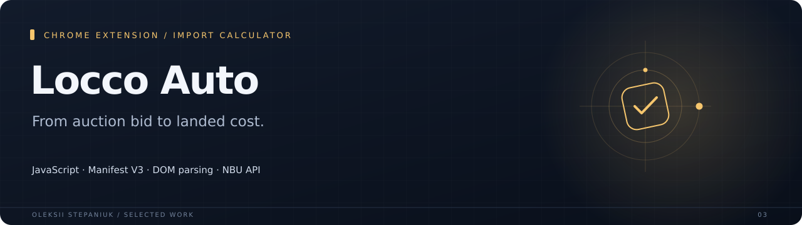
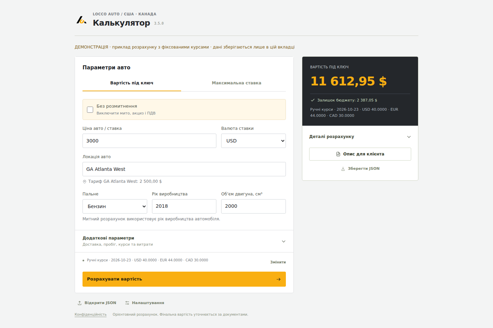

A Chrome extension that places a landed-cost calculator alongside auction listings. It reads vehicle details, calculates a maximum bid from a target budget and prepares a short client-facing summary.

**JavaScript · Manifest V3 · DOM parsing · NBU API**

## Why I built it

Estimating an imported car means combining the bid, auction fees, delivery, currency conversion and customs. Repeating that calculation by hand slows down every client consultation.

## What it does

| Area | Behavior |
| --- | --- |
| **Auction pages** | Copart, IAAI and Bidfax parsers, including different listing layouts. |
| **Cost engine** | USD/CAD, delivery, auction fees, customs and a separate calculation without customs. |
| **Budget planning** | Maximum-bid calculation, manual corrections and per-lot persistence. |
| **Daily tools** | Client descriptions, JSON export, available photo downloads and an optional Windows updater. |

## Interface

## Engineering notes

`npm test` checks cost modes, maximum bids, currencies, location matching, hidden prices, per-lot data and widget behavior against modeled pages.

The latest packaging checks are recorded in [docs/verification.md](docs/verification.md).

## Project state

Version 3.5.0. The extension runs directly from its unpacked folder. Bundled tariffs are a reference snapshot and must be reviewed for a real quote. DOM tests use fixtures; auction anti-bot pages and future layout changes can affect live parsing.

## Source

Implementation source is not included in this case-study repository.

---

[Oleksii Stepaniuk](https://github.com/bird24h) · [Project collection](../README.md)
