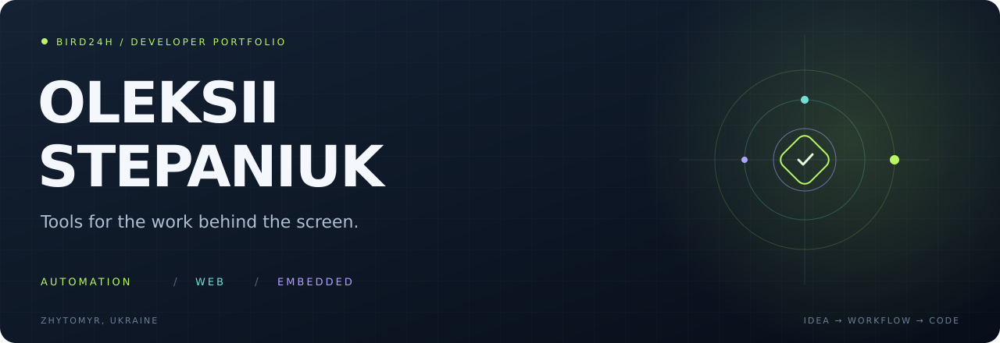
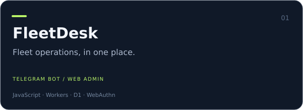
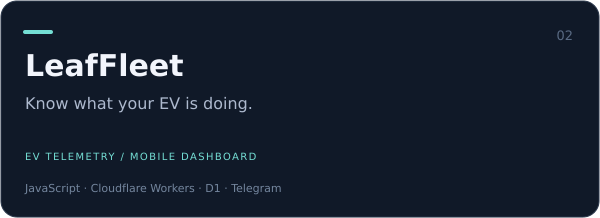
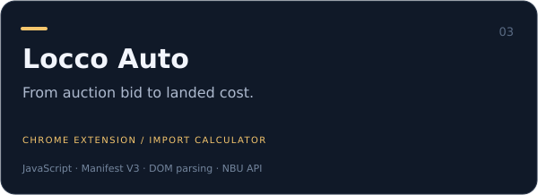
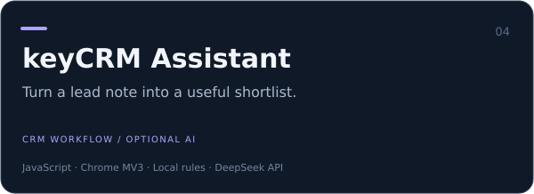
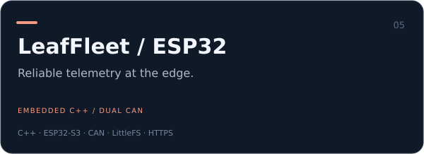
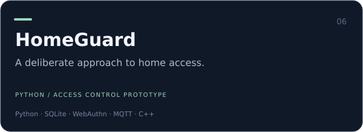

I build tools for real workflows: fleet operations, vehicle imports, CRM and connected devices.
My projects start with problems I see in daily work, then turn into a browser extension, a Telegram workflow, a web panel or an ESP32 device.

Based in Zhytomyr, Ukraine. Interested in automation development and practical web projects.

### Selected work

<table>
<tr><td width="50%"></td><td width="50%"></td></tr><tr><td width="50%"></td><td width="50%"></td></tr><tr><td width="50%"></td><td width="50%"></td></tr>
</table>

Also in progress: [Auction Vault](https://github.com/bird24h/locco-auto-privacy/tree/main/portfolio/auction-vault) — an encrypted auction catalog with a browser capture bridge and Google Drive synchronization.

### What I work with

| Area | Tools |
| --- | --- |
| Applications | JavaScript, HTML, CSS, Python |
| Automation | Telegram Bot API, Chrome extensions, CRM workflows, service APIs |
| Cloud | Cloudflare Workers, D1, SQLite, Docker |
| Devices | ESP32-S3, C++, CAN, MQTT, LittleFS |
| Engineering | Automated checks, explicit access rules, offline behavior, setup documentation |

### A few decisions behind the code

- FleetDesk keeps the driver workflow in Telegram and the fleet overview in a web panel.
- LeafFleet keeps device ingestion, operator access and demonstration data separate.
- The ESP32 delivery queue waits for an acknowledgement of the exact sample before removing it.
- The CRM shortlist uses local rules; an AI provider is optional for extra questions.
- HomeGuard treats a missing command receipt as an unknown outcome and blocks automatic retries.

Each case study includes the problem, interface, technical choices and validation limits.

**Українською:** створюю інструменти для автопарків, автопідбору й щоденних робочих процесів. Цікавлять задачі з автоматизації, веброзробки та інтеграцій.
